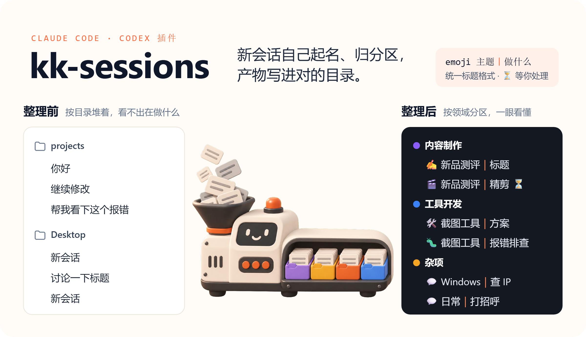
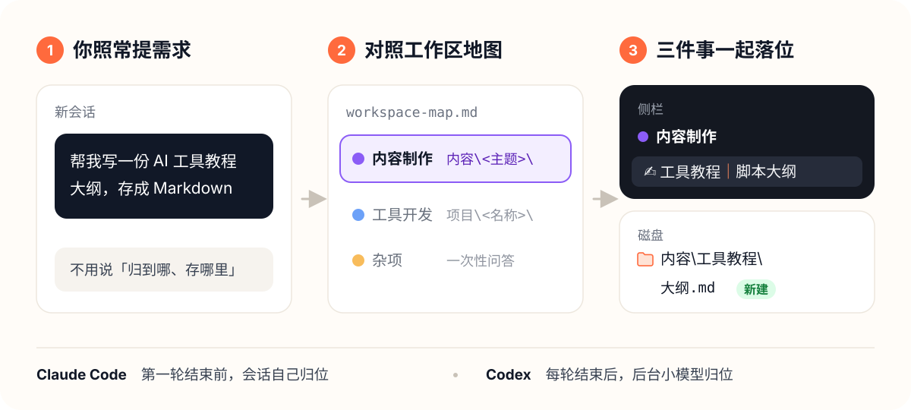

<p align="center">
  
</p>

<p align="center">
  
  
  
  
</p>

会话开多了，常常想不起某份稿子是在哪个会话里写的、存到了哪个目录。kk-sessions 给 AI 一张**工作区地图**：哪类事放哪个分区、文件存到哪里。之后每个新会话都会按地图自己起标题、放进侧栏分区，产物写进对应的主题目录。不满意随时一键回退。

<p align="center">
  
</p>

## 三步上手

**1. 安装插件。** 把这句话发给 Claude Code 或 Codex，它会自己装好：

> 帮我安装 kk-sessions 插件：https://github.com/kkfor30/kk-sessions

只用其中一个，就只在那一个里发；两个都装时共用同一张工作区地图。需要本机有 Python 3.8 以上（Windows 用 `py` 启动器，python.org 的安装包默认带）。

**用 Codex 的话**，装完到「设置 → Hooks」里信任 kk-sessions 的三个钩子，这是唯一需要你手动点的一步。

<details>
<summary>想自己在终端里装</summary>

Claude Code：

```bash
claude plugin marketplace add kkfor30/kk-sessions
claude plugin install kk-sessions@kk-sessions
```

Codex：

```bash
codex plugin marketplace add kkfor30/kk-sessions
codex plugin add kk-sessions@kk-sessions
```

插件包含四个 Skill 和三个钩子，不改你的全局指令文件。

</details>

**2. 初始化。** 新开一个会话，说「初始化会话分区」。它会读你现有会话的标题和目录，拟一套分区和对应目录，你确认后写入 `~/.agent-rules/workspace-map.md`，并在侧栏建好分区。之后可以接着说「整理会话」，把旧会话一次归好。

**3. 日常使用。** 照常提需求就行，不需要额外操作。某个会话没归位时，在里面说一句「路由一下」即可补上。

## 四个 Skill

| Skill | 怎么触发 | 做什么 |
| --- | --- | --- |
| `kk-session-setup` | 「初始化会话分区」 | 生成工作区地图，建侧栏分区 |
| `kk-session-route` | 新会话第一轮自动执行；或说「路由一下」 | 判断分区和目录，建目录和 README，切目录，命名，归入分区 |
| `kk-session-tidy` | 「整理会话」 | 补齐标题格式和分区，对长会话提改名建议，列出待推进的会话 |
| `kk-session-restore` | 「撤销 kk-sessions 的改动」 | 把会话标题和分区恢复成第一次使用前的样子 |

工作区地图是唯一的规则来源，改分区或目录只改这一个文件。遇到和现有分区都对不上的新内容，归位时会提议一个新分区和根目录，你同意了才建。

## 标题规则

格式是 `<类型emoji> <主题>｜<这次做什么>`，例如 `🎬 新品测评｜口播精剪`。侧栏分区表示领域，开头的 emoji 表示这次做哪类事。

| ✍️ 策划 | 🔍 调研 | 🧪 测试 | 🎬 制作 | 📤 发布 | 🛠️ 开发 | 🐛 排查 | 💬 问答 |
| --- | --- | --- | --- | --- | --- | --- | --- |

- 主题第一次命名后就锁定；emoji 和｜后半段只在 `kk-session-tidy` 提出建议、你确认后才改。
- 回复结尾留下只有你能做的事（选方案、验收、补素材）时，标题末尾会加 ` ⏳`。之后每轮开头会提醒模型按当前标题维护：你给了选择或材料、事情办完，或者说了「不用管了」，这一轮结束时就去掉；你也可以随时自己删掉。
- 置顶只由你手动操作。

## 两个 Agent 分别怎么做

| | 谁来归位 | 改名 | 分区 | 切目录 |
| --- | --- | --- | --- | --- |
| Claude Code 桌面端 | 会话本身，第一轮结束前 | 自动 | 自动 | 自动（批准一次） |
| Codex 桌面端 | 后台独立模型，前几轮结束后 | 自动 | 自动 | 由你在侧栏拖动 |

「切目录」是把会话的工作目录换到地图里的目标目录，「产物写到哪」是另一回事：要产出文件的任务，不管会话开在哪个文件夹，文件都会直接写进地图里的主题目录。Codex 不允许 Agent 把会话移到别的项目，回复最后会告诉你产物在哪。

### Claude Code

归位由会话本身的模型在对话里完成，因为 Claude 桌面端的侧栏只能在会话内部操作。

- **模型最低建议用 Sonnet 5.5、推理强度 high**，更强的模型或更高的推理强度都可以。不建议用 Haiku，也不建议 high 以下的推理强度：实测 Sonnet medium 回答完问题就直接结束了，没有改标题和归区。
- 另外装了一个收尾检查钩子：新会话第一轮结束时如果还没改标题，会拦一次，让模型补做归位。这个检查**只在桌面端生效**；命令行 `claude`、`claude -p` 和 Agent SDK 没有侧栏，不会被拦。

### Codex

标题和分区由后台独立模型完成，和你选的会话模型无关。

- 默认模型是 `gpt-6-luna`，推理强度 low，通常在回复结束后 20 到 40 秒改好；网络不稳出错时，一分钟后会在后台自动再试一次；账号用不了这个模型时，会自动换成 Codex 默认模型。想换模型，在 `~/.agent-rules/kk-sessions/config.json` 里写 `{"codex_model": "模型名", "codex_effort": "low"}`。
- **会发给模型的内容**：工作区地图，加上新会话前三轮内每轮的用户消息（最多 1200 字）和助手回答的结尾（最多 800 字）。走的是你自己的 Codex 账号，和平时对话的去处一样。每次的结果记在同目录的 `codex/log.jsonl`。
- **依赖未公开接口**：结果是通过 Codex 桌面端的内部工具通道写回侧栏的，侧栏会立即刷新；这个通道不可用时，退回 Codex app-server 的实验接口，侧栏要等桌面端重新加载后才显示。这两个接口都不是公开 API，Codex 升级后可能失效，失效时日志里会出现 `error`。这时在会话里说「路由一下」，会改由会话模型用 Codex 正式提供的工具完成归位。

## 不满意，一键恢复

只想暂时不用：停用插件即可，之后的新会话不再受影响，已经改过的标题和分区保持原样。

想把侧栏恢复成用 kk-sessions 之前的样子：kk-sessions 第一次改动侧栏前会存一份快照（`~/.agent-rules/kk-sessions/snapshots/`，只记会话标题、分区和是否归档），并把回退工具复制到 `~/.agent-rules/kk-sessions/restore/`，**卸载插件后也还在**。

- **Claude Code**：在会话里说「撤销 kk-sessions 的改动」。插件已卸载时，说「读 ~/.agent-rules/kk-sessions/restore/RESTORE.md，按里面的流程撤销 kk-sessions 的改动」。
- **Codex**：在会话里说「撤销 kk-sessions 的改动」，或者自己运行（不调模型，Codex 桌面端要开着）：

  ```bash
  python ~/.agent-rules/kk-sessions/restore/restore.py           # 先看要改什么
  python ~/.agent-rules/kk-sessions/restore/restore.py --apply   # 确认后执行
  ```

恢复会把 kk-sessions 改的标题改回原样、会话移回原来的分区、删掉 kk-sessions 建的分区。你后来自己改过的标题、放进自己分区的会话会跳过，置顶不动；会话本身和磁盘上的文件夹都不动。恢复前的样子会另存一份，想撤回这次恢复也有据可查。

<details>
<summary><b>不用插件，用安装脚本</b></summary>

不想用插件系统，或者自己维护共享 Skill 库时，可以用安装脚本把同样的 Skill 和钩子写进配置文件。和插件二选一，不要同时装。

```bash
git clone https://github.com/kkfor30/kk-sessions.git
cd kk-sessions
python install.py                   # 装到检测到的全部 Agent
python install.py --agents codex    # 只装某个 Agent
python install.py --dry-run         # 只打印将要做的事
python install.py --uninstall       # 卸载
```

- 自己维护共享 Skill 库时，加 `--skills-dir <目录>` 把 Skill 装到那里，钩子会指向它；如果 Skill 已经另行装好，再加 `--no-skills`。
- 首次修改配置前，会把原文件备份为 `<文件名>.kk-sessions.bak`。卸载只移除本项目写入的部分，工作区地图会保留。
- 钩子命令里是本机 Python 的绝对路径，换了 Python 后 Codex 要重新信任一次；插件没有这个问题。

</details>

<details>
<summary><b>写入了哪些文件</b></summary>

| | Claude Code | Codex |
| --- | --- | --- |
| 插件 | `~/.claude/plugins/`：四个 Skill + 新会话启动提示、每轮 ⏳ 提醒、收尾检查三个钩子 | `~/.codex/plugins/`：四个 Skill + 新会话启动说明、每轮 ⏳ 提醒、后台归位三个钩子 |
| 工作区地图 | `~/.agent-rules/workspace-map.md`（初始化时生成，两边共用） | 同左 |
| 快照、日志、回退工具 | `~/.agent-rules/kk-sessions/`（卸载插件后保留） | 同左 |

用安装脚本时，Skill 装到 `~/.claude/skills/`、`~/.codex/skills/`，钩子写进 `~/.claude/settings.json`、`~/.codex/hooks.json`。

规则（产物写到哪、什么时候加 ⏳）由钩子交给模型（启动时一次，⏳ 每轮一句提醒），不写进 `CLAUDE.md` 或 `AGENTS.md`。旧版写进这两个文件的 `<!-- kk-sessions -->` 规则块，重装时会自动删掉。

</details>

<details>
<summary><b>花费</b></summary>

归位只在新会话开头执行一次。Claude Code 大约用 5 千到 8 千 token，用的是会话本身的模型；Codex 输入约 6 千多 token（大部分是 Codex 固定的系统提示），输出不到 200，用的是后台独立模型。之后每轮只多一句几十到一百多 token 的 ⏳ 提醒，不额外调用模型。`kk-session-setup` 和 `kk-session-tidy` 只读会话的标题、目录和分区，不读聊天记录。

</details>

装好后可以按 [docs/验证清单.md](docs/验证清单.md) 逐项验收。

## License

[MIT](LICENSE)
